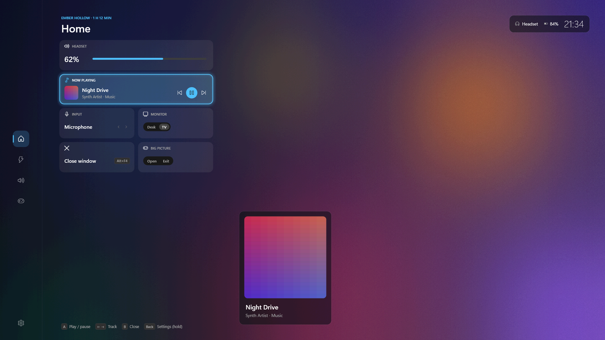
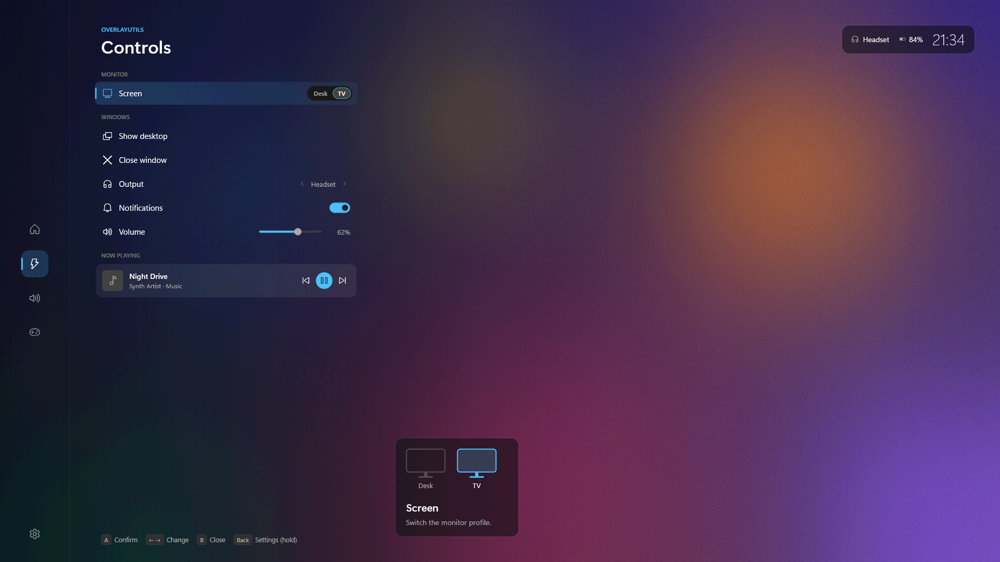
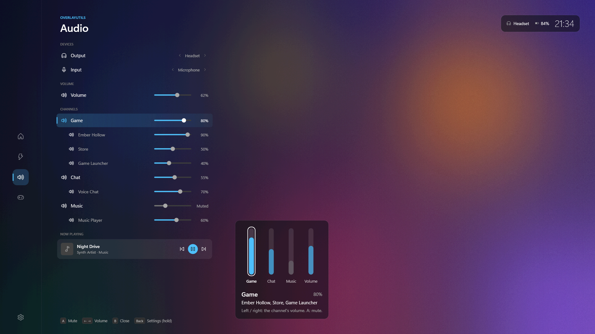
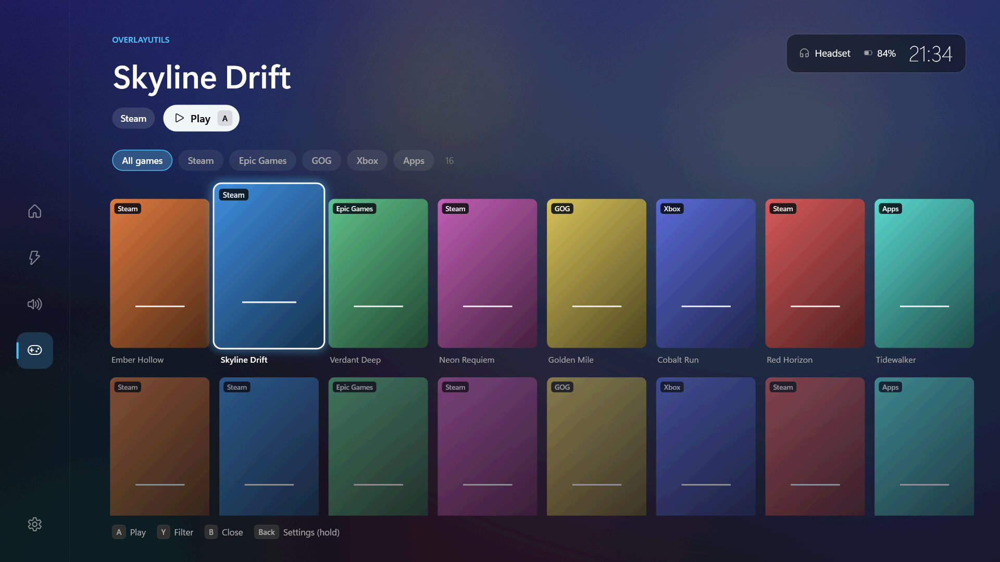
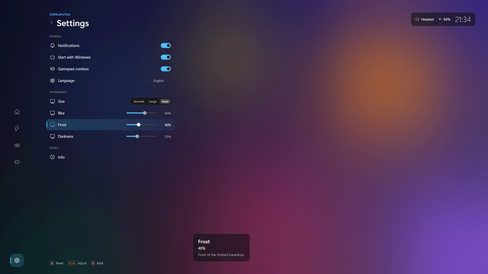

# OverlayUtils

*[Read in English](README.md)*

Un'app nell'area di notifica di Windows con un overlay a schermo intero da
usare dal divano con il pad (o con tastiera e mouse alla scrivania). Si
mette sopra il gioco, mostra il gioco dietro come vetro smerigliato e tiene
a portata di un tasto quello che serve mentre giochi: volume e dispositivi
audio, cosa stai ascoltando, setup dei monitor, la libreria giochi e i
controlli di sistema.



## Cosa c'è dentro

- **Home** - riquadri per volume, in riproduzione, microfono, schermo
  scrivania / TV, chiudi finestra e Steam Big Picture. Quando davanti c'è un
  gioco della tua libreria, Home ne mostra il nome e da quanto è aperto.
- **Controlli** - cambia setup dei monitor (con
  [Monitor Profile Switcher](https://monitorprofileswitcher.com/)), mostra il
  desktop, chiudi la finestra dietro, sospendi / riavvia / spegni.
- **Audio** - uscita e microfono, volume, un mixer a canali (Gioco, Chat,
  Media, Altro) con i programmi di ciascuno, preset e controlli multimediali.
  I dispositivi cambiano da soli secondo una lista di priorità che scegli tu.
- **Giochi** - tutto ciò che hai installato da Steam (scorciatoie non Steam
  comprese), Epic, GOG, l'app Xbox / PC Game Pass e gli emulatori più comuni,
  più qualsiasi programma aggiunto da te. Copertine, filtri per fonte, avvio
  con A.
- **Combinazioni del pad** a overlay chiuso: profilo monitor, volume, muto
  del microfono.
- **Rimappatura del tasto Home** - il tasto "Browser Home" della tastiera
  diventa il tasto Windows o Alt+Tab.
- **Aspetto** - sfocatura, brina e oscurità dello sfondo, e una dimensione
  più grande per la TV (scelta da sola sul profilo monitor della TV).
- **Italiano e inglese**, secondo la lingua di Windows o scelta dal menu.

Funziona con qualsiasi controller supportato da SDL (Xbox, DualShock 4,
DualSense, Switch Pro, 8BitDo, il pad virtuale di Moonlight...). Nessun
driver da installare.

| | |
|---|---|
|  |  |
|  |  |

*Le immagini usano dati di esempio inventati e l'interfaccia in inglese.*

> **Stato:** il passaggio dall'app Python originale ("AppUtili") a .NET è
> completo e l'overlay è appena stato ridisegnato; ora è in prova su TV e
> scrivanie vere. Vedi [docs/PORTING.md](docs/PORTING.md) (in inglese). Il
> nome "OverlayUtils" è provvisorio.

## Due modalità

| | Standard | Completa |
|---|---|---|
| Installazione | estrai lo zip e avvia `OverlayUtils.exe` | un clic nelle Impostazioni o nel menu, una richiesta di amministratore |
| Overlay sopra desktop, finestre, giochi senza bordi, Big Picture | sì | sì |
| Overlay sopra i giochi a **schermo intero esclusivo** | no | sì |
| Certificato installato sul PC | no | sì (rimosso quando la disattivi) |

La modalità completa richiede il permesso **UIAccess** di Windows, che Windows
concede solo a programmi firmati e installati in Programmi. OverlayUtils se ne
occupa quando la attivi e annulla tutto quando la disattivi. Rendere
attendibile un certificato significa che Windows accetta qualsiasi cosa
firmata con esso: attiva la modalità completa solo con versioni ricevute da
qualcuno di cui ti fidi.

## Uso

Apri l'overlay con **Back + RB** sul pad, **Maiusc+F1** dalla tastiera o un
clic sull'icona. Dentro: croce direzionale per muoverti, A per scegliere, B
per tornare indietro, LT / RT per cambiare pagina, tieni premuto Back per le
Impostazioni. La guida completa è [README.txt](README.txt) (lo stesso file è
nello zip).

Arrivi da **AppUtili**? Le impostazioni vengono copiate da sole al primo
avvio (Spotify e Discord non fanno parte di OverlayUtils), e il menu
dell'icona propone di rimuovere la vecchia installazione.

## Privacy

Nulla esce dal tuo PC. Per disegnare lo sfondo smerigliato, l'overlay fa una
sola foto dello schermo quando si apre, la tiene solo in memoria e la butta
quando si chiude; non viene mai salvata. La riga "in gioco" confronta solo il
programma in primo piano con le cartelle di installazione dei tuoi giochi.

## Compilazione

Serve: Windows 10/11, .NET 10 SDK (oppure Visual Studio 2026 con il carico di
lavoro Sviluppo di applicazioni desktop .NET).

```powershell
# una volta: crea la tua chiave di firma (non servono permessi di amministratore)
powershell -NoProfile -ExecutionPolicy Bypass -File scripts\certificate.ps1

# compila, firma e crea lo zip -> dist\OverlayUtils e dist\OverlayUtils-<versione>.zip
powershell -NoProfile -ExecutionPolicy Bypass -File scripts\build.ps1
```

Lo zip è autonomo: sul PC di destinazione non serve installare .NET.
`-NoSign` compila senza certificato (solo modalità standard). Per lo
sviluppo apri `OverlayUtils.sln` ed esegui il progetto `OverlayUtils`; le
verifiche della libreria principale girano ovunque:

```
dotnet run --project tests/OverlayUtils.SelfTest
```

Chi compila firma con la propria chiave, così nessuno deve fidarsi del
certificato di un altro. Una build data ad altri come zip chiede loro di
fidarsi del *tuo* certificato quando attivano la modalità completa.

## Guida al repository

[CLAUDE.md](CLAUDE.md) (in inglese) è il punto di partenza per chi
contribuisce: struttura, convenzioni e dove è documentato ogni argomento.
