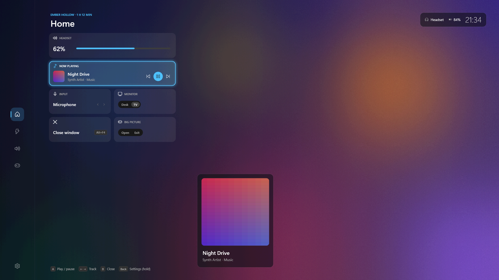
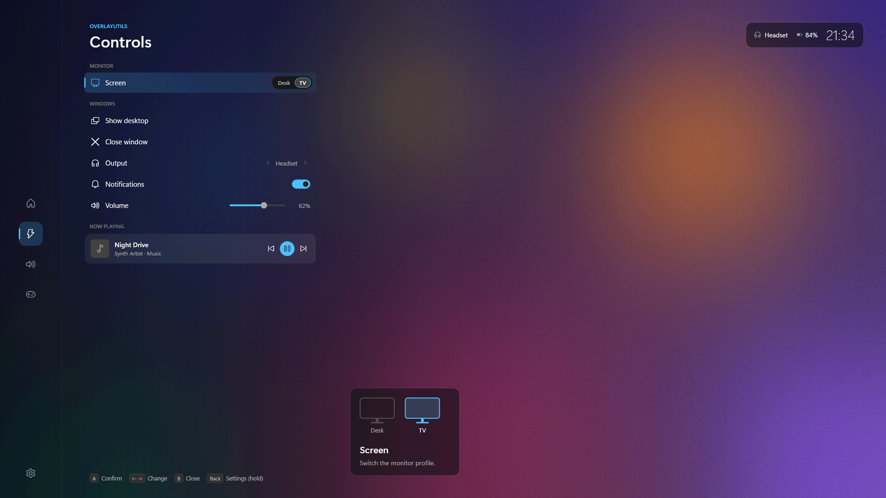
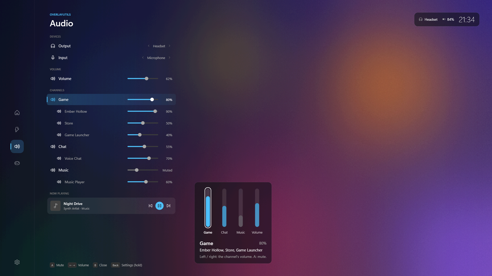
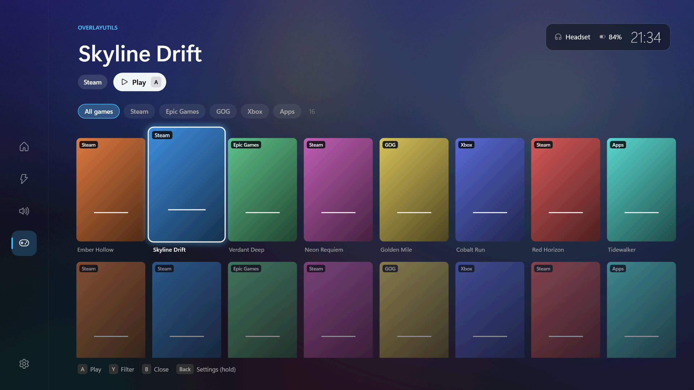
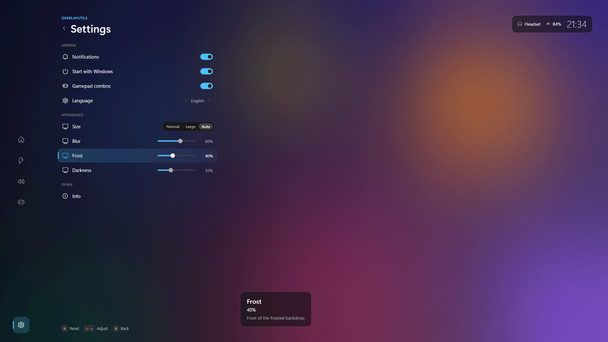

# OverlayUtils

*[Leggi in italiano](README.it.md)*

A Windows tray app with a full-screen overlay you drive from the couch with a
gamepad (or with keyboard and mouse at the desk). It sits on top of your
game, shows the game behind as frosted glass, and puts the things you reach
for mid-game one press away: volume and audio devices, what's playing,
monitor setups, your games library, and system controls.



## What's inside

- **Home** - shortcut tiles for volume, now playing, microphone, desk / TV
  screen, close window and Steam Big Picture. When a game from your library
  is in front, Home shows its name and how long it has been running.
- **Controls** - switch monitor setups (with
  [Monitor Profile Switcher](https://monitorprofileswitcher.com/)), show the
  desktop, close the window behind, sleep / restart / shut down.
- **Audio** - output and microphone, volume, a mixer of channels (Game, Chat,
  Media, Other) with the programs in each, presets, and media controls.
  Devices switch automatically by a priority list you set.
- **Games** - everything you have installed from Steam (non-Steam shortcuts
  included), Epic, GOG, the Xbox app / PC Game Pass and common emulators,
  plus any program you add. Covers, source filters, launch with A.
- **Pad combos** with the overlay closed: monitor profile, volume, mic mute.
- **Home key remapping** - make the keyboard's "Browser Home" key act as the
  Windows key or Alt+Tab.
- **Appearance** - blur, frost and darkness of the backdrop, and a larger
  size for the TV (picked automatically on the TV monitor profile).
- **English and Italian**, following Windows or chosen in the menu.

Works with any controller SDL supports (Xbox, DualShock 4, DualSense, Switch
Pro, 8BitDo, Moonlight's virtual pad...). No drivers to install.

| | |
|---|---|
|  |  |
|  |  |

*Screenshots use made-up sample data.*

> **Status:** the port from the original Python app ("AppUtili") to .NET is
> complete and the overlay has just been redesigned; it is being tested on
> real TVs and desks now. See [docs/PORTING.md](docs/PORTING.md). The name
> "OverlayUtils" is a working title.

## Two modes

| | Standard | Full |
|---|---|---|
| Setup | unzip and run `OverlayUtils.exe` | one click in Settings or the tray menu, one admin prompt |
| Overlay over desktop, windows, borderless games, Big Picture | yes | yes |
| Overlay over **exclusive fullscreen** games | no | yes |
| Certificate installed on the PC | no | yes (removed again when you turn it off) |

Full mode needs the Windows **UIAccess** permission, which Windows only grants
to signed programs installed in Program Files. OverlayUtils handles both when
you enable it and undoes them when you disable it. Trusting a certificate
means Windows accepts anything signed with it, so only enable full mode for
builds from someone you trust.

## Using it

Open the overlay with **Back + RB** on the pad, **Shift+F1** on the keyboard,
or a click on the tray icon. Inside: D-pad to move, A to select, B to go back,
LT / RT to switch page, hold Back for Settings. The full guide is
[README.txt](README.txt) (the same file ships in the zip).

Coming from **AppUtili**? Settings are copied automatically on first start
(Spotify and Discord are not part of OverlayUtils), and the tray menu offers
to remove the old install.

## Privacy

Nothing leaves your PC. To draw the frosted backdrop, the overlay takes one
picture of the screen when it opens, keeps it in memory only, and drops it
when it closes; it is never saved. The "currently playing" line only compares
the program in front with the install folders of your games.

## Building

Requirements: Windows 10/11, .NET 10 SDK (or Visual Studio 2026 with the
.NET desktop development workload).

```powershell
# once: create your signing key (no admin needed)
powershell -NoProfile -ExecutionPolicy Bypass -File scripts\certificate.ps1

# build, sign and zip -> dist\OverlayUtils and dist\OverlayUtils-<version>.zip
powershell -NoProfile -ExecutionPolicy Bypass -File scripts\build.ps1
```

The zip is self-contained: the target PC needs no .NET install. `-NoSign`
builds without a certificate (standard mode only). For day-to-day work open
`OverlayUtils.sln` and run the `OverlayUtils` project; checks for the core
library run anywhere:

```
dotnet run --project tests/OverlayUtils.SelfTest
```

Each person who builds signs with their own key, so nobody has to trust
someone else's certificate. A build given to others as a zip asks them to
trust *your* certificate when they enable full mode.

## Repository guide

[CLAUDE.md](CLAUDE.md) is the starting point for contributors (and coding
agents): layout, conventions and where each topic is documented.
